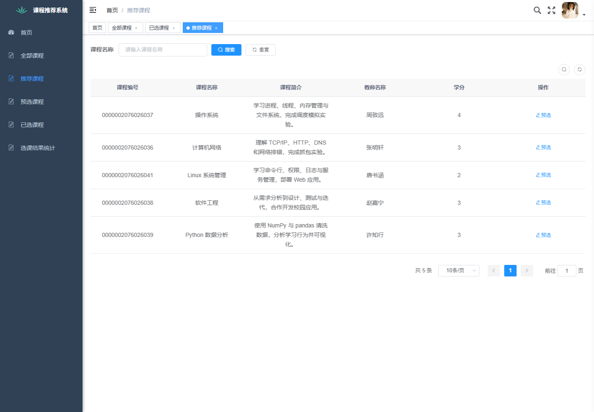
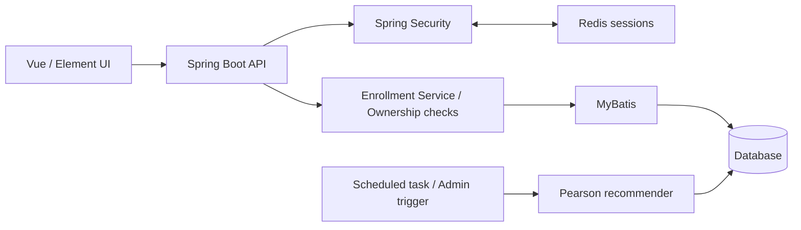
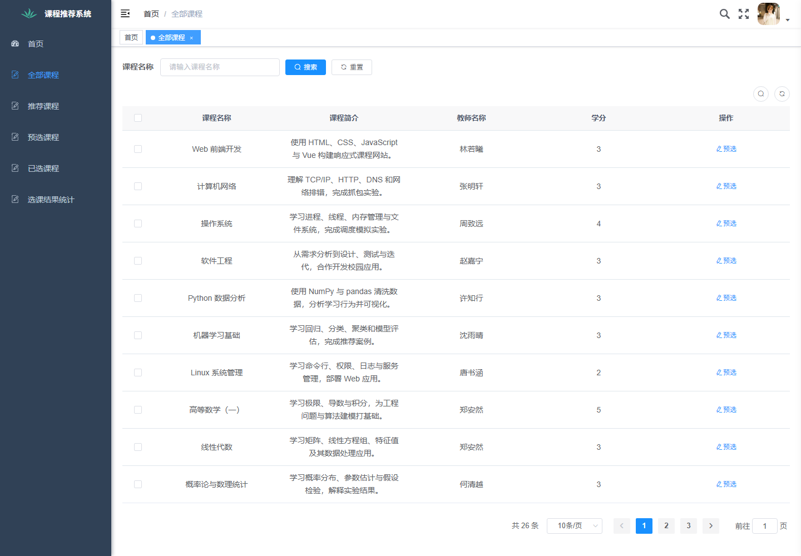
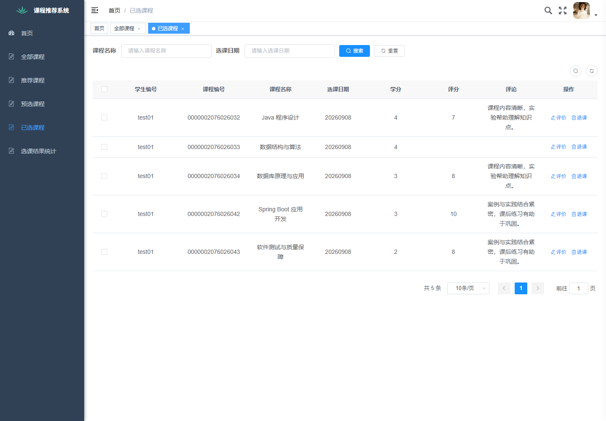

# 履修・科目推薦システム

[English](README.md) · 日本語 · [中文](README.zh-CN.md)

RuoYi-Vue を基盤とした、学部卒業研究の初期版に由来する Java Web アプリケーションです。科目検索、履修登録、評価、個別推薦を扱います。2026 年に Codex を活用し、動作環境の復旧、不具合の調査・修正、テストの追加を行いました。

このポートフォリオでは、設計と抜粋コードを紹介します。アプリケーション全体のソースコードは非公開で、面接時に説明できます。**現在のアプリ画面は中国語です。英語・日本語の説明資料を用意しています。**

未履修科目を推薦します。個別予測による候補を優先し、不足分を人気科目で補います。画面の中国語表記は[日本語の画面ガイド](screenshots.ja.md)で説明しています。

## プロジェクトの概要

- **操作の流れ：** 科目検索 → 仮登録 → 履修確定 → 評価・コメント → 未履修科目の推薦。
- **推薦方式：** Pearson 相関係数によるユーザーベース協調フィルタリング。正の類似度で重み付けし、不足時は人気順で補完します。
- **実装上の工夫：** Service 層の所有者チェック、履修状態の検証、DB の一意制約、取得時の履修済み科目の再除外。
- **技術構成：** Java、Spring Boot、Spring Security、MyBatis、Redis、MySQL 互換 DB、Vue 2、Element UI。

| 資料 | 確認できる点 |
| --- | --- |
| [推薦順位と人気科目による補完](code/recommendation.ja.md) | 安定した並び順、重複排除、候補不足への対応 |
| [履修データの権限と整合性](code/enrollment.ja.md) | 認証済みユーザー、所有者検証、同時登録 |
| [推薦設計と評価](design.ja.md) | 処理の流れ、評価方法、制約 |
| [画面ガイド](screenshots.ja.md) | 中国語の主な項目と操作の流れ |

抜粋元は非公開プロジェクトの固定リビジョン `f50db224a72bcbdd324f288c8d25142c7feafe55` です。抜粋コードのみではアプリ全体を実行できません。

## システム構成

## コードの出典と担当範囲

| 対象 | 出典 |
| --- | --- |
| 認証、RBAC、メニュー、ログ、コード生成、基本 UI | RuoYi-Vue フレームワーク |
| 科目・履修・評価機能、既存の 3 種類の推薦実装 | 学部卒業研究の初期版に含まれていた業務コード。すべてを独自開発とする主張はしません |
| 権限修正、決定的な計算処理の分離、テスト、匿名のデモデータ、説明資料 | 2026 年の Codex を活用した復旧・保守 |

業務ロジックと修正理由を説明できることを重視しています。卒業研究の最終提出版ではなく、フレームワークの機能を個人の独自成果として扱っていません。

## 検証結果と制約

元プロジェクトには、**2026 年 10 月 12 日に Maven テスト 20 件、実 HTTP による受け入れ確認 27 件が成功した記録**があります。今回は文書の更新であり、アプリのテストは再実行していません。

架空の学生 5 人、科目 31 件、評価 26 件による留一法では、Recall@5 は推薦方式・人気順ベースラインともに 0.384615 でした。NDCG@5 は推薦方式が 0.277320、人気順が 0.356225 です。推薦精度の向上を示す結果ではありません。[評価の詳細](design.ja.md)をご覧ください。

実ユーザーへの効果や本番規模の負荷は未検証です。外部公開を検討する場合、古いフレームワーク依存関係の確認と更新が必要です。

## 画面例

| 科目一覧 | 履修・評価 |
| --- | --- |
|  |  |

元プロジェクトで記録された架空アカウントによるデモ画像を使用しています。[日本語の画面ガイド](screenshots.ja.md)を併せてご覧ください。公開ログイン、実行環境の設定、DB 全体は含めていません。

## 出典・ライセンス

[RuoYi-Vue](https://gitee.com/y_project/RuoYi-Vue) 3.8.6 を基盤とし、元の [MIT ライセンス](LICENSE)を保持しています。ポートフォリオ用途という説明によって既存の許諾を取り消すものではありません。未掲載のアプリケーションコードは非公開です。
