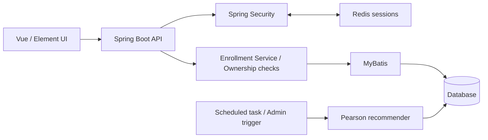

# Course Recommendation System

English · [日本語](README.ja.md) · [中文](README.zh-CN.md)

A Java web application based on an early undergraduate graduation-project version built with RuoYi-Vue. It supports course browsing, enrollment, ratings and personalized recommendations. In 2026, Codex assisted with restoring the application, reviewing defects and adding tests.

This portfolio contains selected source excerpts and design explanations. The complete application source remains private and can be discussed during an interview. **The application UI is currently in Chinese; English and Japanese documentation is provided.**

The recommendation screen presents courses that the student has not enrolled in. Personalized candidates are ranked first; popular unseen courses fill any remaining slots. See the [screenshot reading guide](screenshots.md) for translated labels.

## What to review

- **Workflow:** browse courses → pre-enroll → confirm enrollment → rate and comment → receive recommendations.
- **Recommendation logic:** Pearson user-based collaborative filtering with positive-similarity weighted predictions and popularity fallback.
- **Engineering:** Service-layer ownership checks, enrollment-state validation, a database uniqueness constraint and query-time exclusion of enrolled courses.
- **Stack:** Java, Spring Boot, Spring Security, MyBatis, Redis, a MySQL-compatible database, Vue 2 and Element UI.

| Selected implementation | Review focus |
| --- | --- |
| [Ranking and popularity fallback](code/recommendation.md) | Stable ordering, deduplication, sparse candidates |
| [Enrollment authorization and consistency](code/enrollment.md) | Authenticated identity, ownership, concurrent duplicates |
| [Recommendation design and evaluation](design.md) | Data flow, evaluation protocol, limitations |
| [Screenshot reading guide](screenshots.md) | Translated UI vocabulary and demonstration flow |

Source excerpts come from private-project revision `f50db224a72bcbdd324f288c8d25142c7feafe55`. They are reading samples, not a standalone runnable application.

## Architecture

## Provenance and contribution boundaries

| Area | Origin |
| --- | --- |
| Authentication, RBAC, menus, logging, code generation and base UI | RuoYi-Vue framework |
| Course, enrollment, rating and three original recommendation implementations | Existing business code in the early undergraduate project; not claimed as entirely original work |
| Authorization repairs, deterministic calculation extraction, tests, sanitized demo data and portfolio documentation | 2026 restoration and maintenance assisted by Codex |

The focus is explaining the business logic and engineering decisions. This is not the recovered final graduation submission, and framework features are not presented as independently developed work.

## Validation and limitations

The original project records **20 passing Maven tests and 27 passing real HTTP acceptance checks on October 12, 2026**. These are historical results; application tests were not rerun for this documentation update.

The evaluation uses 5 fictional students, 31 courses and 26 held-out ratings. Recall@5 is 0.384615 for both Pearson + fallback and the popularity baseline. NDCG@5 is 0.277320 versus the baseline's 0.356225. These results do **not** demonstrate improved recommendation accuracy. See [evaluation details](design.md).

No real-user effectiveness or production-load validation is available. The older framework dependencies require review and upgrades before considering public deployment.

## Screenshots

| Course browsing | Enrollments and ratings |
| --- | --- |
|  |  |

Screenshots are reused from the project's recorded fictional-account demonstration. [English label guide](screenshots.md) · [日本語の画面説明](screenshots.ja.md). No public login, runtime configuration or full database is included.

## Attribution and license

Based on [RuoYi-Vue](https://gitee.com/y_project/RuoYi-Vue) 3.8.6. The original [MIT license](LICENSE) is retained. A portfolio-purpose statement does not revoke existing permissions. Unpublished application source remains private.
