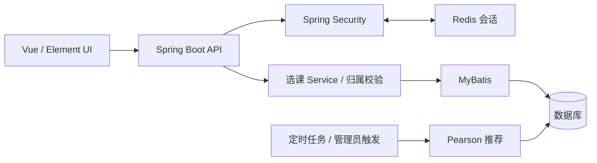

# 课程推荐系统 · 项目展示

[English](README.md) · [日本語](README.ja.md)

基于 RuoYi-Vue 的本科毕业设计初始版本，覆盖课程查询、预选、确认选课、评价与个性化推荐。2026 年使用 Codex 辅助恢复运行、修复缺陷并补充测试。本仓库展示精选代码与工程思路，完整应用源码暂不公开，可在面试中结合完整项目讲解。

## 快速了解

- **业务流程**：查询课程 → 预选 → 确认 → 评分与评论 → 推荐未选课程。
- **推荐方案**：Pearson 用户协同过滤，使用正相似度邻居加权预测；候选不足时按热门课程补齐。
- **工程处理**：Service 层校验选课归属、评分前检查确认状态、唯一索引防止重复选课、查询时再次排除已选课程。
- **技术栈**：Java、Spring Boot、Spring Security、MyBatis、Redis、MySQL 协议数据库、Vue 2、Element UI。

## 精选代码导读

| 展示内容 | 阅读重点 |
| --- | --- |
| [推荐排序与热门补齐](code/recommendation.md) | 确定性排序、去重、候选不足处理 |
| [选课权限与一致性](code/enrollment.md) | 服务端身份、归属检查、并发重复提交 |
| [推荐设计与评估](design.md) | 数据流、测试口径、效果局限 |

示例直接摘自私有项目固定版本 `f50db224a72bcbdd324f288c8d25142c7feafe55`。它们是阅读片段，不是可独立运行的完整应用。

## 架构

## 来源与贡献边界

| 部分 | 来源 |
| --- | --- |
| 认证、RBAC、菜单、日志、代码生成、基础 UI | RuoYi-Vue 框架 |
| 课程、选课、评分、原有三种推荐算法业务 | 本科毕设初始版本中已有的代码；不声明全部独立原创 |
| 权限修复、确定性推荐计算提取、测试、脱敏数据及展示文档 | 2026 年 Codex 辅助恢复与维护 |

展示重点是能解释的业务实现与修复过程。不是找回的最终毕设版本，也不将框架功能作为个人独立开发成果。

## 验证与局限

原项目记录的 2026-10-12 本地验证结果：20 个 Maven 测试通过、27 项真实 HTTP 验收通过。本次仅整理展示材料，未重新运行这些测试。

虚构数据为 5 位学生、31 门课程；26 条评分的留一评估中，Pearson + 热门补齐的 Recall@5 为 0.384615，与热门基线相同；NDCG@5 为 0.277320，低于基线 0.356225。不能据此宣称准确率提升。详见[评估说明](design.md)。

暂无真实用户效果或生产负载验证。旧框架依赖需要升级审查后才能考虑对外部署。

## 页面预览

| 课程查询 | 已选课程与评价 |
| --- | --- |
|  |  |

图片复用原项目记录的虚构演示账号截图。本展示不提供线上账号、运行配置或完整数据库。

## 来源与授权

基于 [RuoYi-Vue](https://gitee.com/y_project/RuoYi-Vue) 3.8.6，保留[原 MIT 许可](LICENSE)。展示用途说明不撤销原代码已有许可，也不意味着禁止他人依原许可使用代码。完整源码保持私有，是控制未展示部分访问范围的方式。
